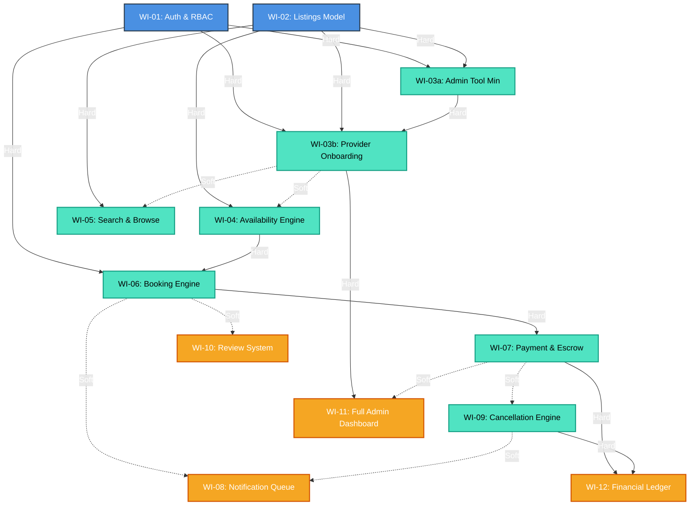

# SkillSwap Dependency DAG & Execution Sequencing (Module 02 — Updated with Cycle Fix)

## 1. Work Item Decomposition (13 Work Items after Node Splitting)

Every requirement from Module 01 maps to these 13 cohesive, buildable work items:

| Work Item ID | Name | Scope & Coverage | Criticality |
| :--- | :--- | :--- | :--- |
| **WI-01** | User Authentication & RBAC | Registration, JWT sessions, role management (Learner, Provider, Admin). | Root Prerequisite |
| **WI-02** | Listings & Provider Catalog Model | Core schema: `providers` (status: pending/approved), `services`, `categories`, city metadata. | Root Prerequisite |
| **WI-03a**| Admin Review Tool (Minimal) | Lightweight admin endpoint (`PATCH /admin/providers/:id/status`) to approve/reject pending providers. | Unblocks Vetting |
| **WI-03b**| Provider Onboarding & Vetting | Verification submission, KYC document collection, state transition to approved. | Core Pipeline |
| **WI-04** | Availability & Slot Schedule Engine | Weekly recurring intervals, blackout dates, slot generation, buffer calculation. | Critical Path |
| **WI-05** | Instant Search & Category Taxonomy | Multi-filter search (category, city, price), Redis caching, DB indexing for p95 < 100ms. | Parallel Track |
| **WI-06** | Booking Engine & Concurrency Locking | Slot reservation, distributed Redis mutex locking, checkout state machine (`HELD` -> `CONFIRMED`). | Critical Path |
| **WI-07** | Payment Processing, Escrow & Commission | Payment gateway integration (Stripe), escrow vaulting, 15% platform commission deduction. | Critical Path |
| **WI-08** | Notification Queue & Email Dispatch | Asynchronous queue (BullMQ/Redis), email templates, booking receipts, `.ics` calendar invites. | Parallel Leaf |
| **WI-09** | Cancellation Engine & Refund Flow | Self-service cancellation UI, policy engine (tiered vs lead-time), refund disbursement, slot release. | Core Consumer |
| **WI-10** | Review System & No-Show Flagging | Post-session star rating & text review, provider no-show reporting, aggregate score computation. | Parallel Leaf |
| **WI-11** | Full Admin Dashboard & Operations | Full admin UI: dispute arbitration, real-time analytics, revenue dashboards, provider management. | Parallel Leaf |
| **WI-12** | Financial Audit Ledger & Telemetry | Double-entry financial audit journal, Prometheus metrics, structured access logs. | Terminal Leaf |

---

## 2. Updated Dependency Matrix (Strictly Acyclic)

| Source Task | Target Task | Type | Rationale |
| :--- | :--- | :--- | :--- |
| **WI-01 (Auth)** | **WI-03a (Admin Tool Min)**| Hard (H) | Admin review tool requires admin identity authentication. |
| **WI-01 (Auth)** | **WI-03b (Onboarding)** | Hard (H) | Provider onboarding requires an authenticated user identity (`user_id`). |
| **WI-01 (Auth)** | **WI-06 (Booking)** | Hard (H) | A booking cannot be recorded without an authenticated learner identity. |
| **WI-02 (Listings Model)** | **WI-03a (Admin Tool Min)**| Hard (H) | Admin tool reads provider rows in `'pending'` status. |
| **WI-02 (Listings Model)** | **WI-03b (Onboarding)** | Hard (H) | Onboarding populates provider and service records. |
| **WI-02 (Listings Model)** | **WI-04 (Availability)** | Hard (H) | Time slots attach to a foreign key in `providers`. |
| **WI-02 (Listings Model)** | **WI-05 (Search)** | Hard (H) | Search indexing requires catalog tables and categories. |
| **WI-03a (Admin Tool Min)**| **WI-03b (Onboarding)** | Hard (H) | Onboarding pipeline completes when admin tool transitions status to `'approved'`. |
| **WI-03b (Onboarding)** | **WI-04 (Availability)** | Soft (S) | Slot engine can test against fixture providers; in production, only approved providers schedule. |
| **WI-03b (Onboarding)** | **WI-05 (Search)** | Soft (S) | Search queries filter `is_vetted = true`; dev tests against fixture providers. |
| **WI-03b (Onboarding)** | **WI-11 (Admin Full)** | Hard (H) | Full dashboard displays approved providers and onboarding metrics. |
| **WI-04 (Availability)** | **WI-06 (Booking)** | Hard (H) | Booking requires an active, unreserved slot identifier to lock. |
| **WI-06 (Booking)** | **WI-07 (Payment)** | Hard (H) | Payment capture requires a verified booking intent and total currency amount. |
| **WI-06 (Booking)** | **WI-08 (Notifications)**| Soft (S) | Booking engine can complete state transitions; email queue connects via event bus mock. |
| **WI-06 (Booking)** | **WI-10 (Reviews)** | Soft (S) | Reviews require a completed booking record; review UI tests against seeded bookings. |
| **WI-07 (Payment)** | **WI-09 (Cancellation)** | Soft (S) | Cancellation refund calls gateway API; rule engine tests with mock refund client. |
| **WI-07 (Payment)** | **WI-11 (Admin Full)** | Soft (S) | Full dashboard displays financial volume and dispute escalation. |
| **WI-07 (Payment)** | **WI-12 (Ledger)** | Hard (H) | Financial ledger captures immutable double-entry records from real payment webhooks. |
| **WI-09 (Cancellation)** | **WI-08 (Notifications)**| Soft (S) | Cancellation triggers emails; business logic does not depend on mailer. |
| **WI-09 (Cancellation)** | **WI-12 (Ledger)** | Hard (H) | Refund deductions and commission reversals record in the financial audit ledger. |

---

## 3. Updated Visual Dependency Graph (ASCII Diagram)

```
       [ WI-01: Auth & RBAC ]              [ WI-02: Listings Model ]
           │          │                          │         │         │
           │(H)       └──────────────┬───────────┘(H)      │(H)      │(H)
           ▼                         ▼                     ▼         ▼
  [ WI-03a: Admin Min ]    [ WI-04: Availability ]   [ WI-05: Search & Browse ]
           │                         │
           │(H)                      │(H)
           ▼                         │
  [ WI-03b: Onboarding ]             │
           │                         │
           │(S)                      │
           └──────────────┬──────────┘
                          ▼
             [ WI-06: Booking Engine ]
               │                 │
               │(H)              │(S)
               ▼                 ▼
     [ WI-07: Payment/Escrow ]  [ WI-08: Notifications ]  [ WI-10: Reviews ]
        │          │                                              ▲
        │(S)       │(H)                                           │(S)
        ▼          └───────────────────────────┐                  │
  [ WI-09: Cancellation ]                      │                  │
   │               │                           │                  │
   │(S)            │(H)                        ▼                  │
   ▼               └───────────────► [ WI-12: Financial Ledger ]  │
[ WI-11: Admin Full ]                                             │
                                                                  │
(Completed Booking fixture feeds Review System) ──────────────────┘
```

---

## 4. Mermaid Graph



---

## 5. Topological Graph Metrics After Fix
- **Total Work Items:** 13 (Acyclic).
- **Root Starting Points:** WI-01 (Auth) and WI-02 (Listings Model).
- **Leaf Endpoints:** WI-08 (Notifications), WI-10 (Reviews), WI-11 (Admin Full), WI-12 (Ledger).
- **Critical Path:** Maintained along core marketplace checkout:
  $$\text{WI-02} \rightarrow \text{WI-04} \rightarrow \text{WI-06} \rightarrow \text{WI-07} \rightarrow \text{WI-12}$$
  Node splitting prevented Admin Tooling from creating a circular dependency or artificially bloating the critical path.
