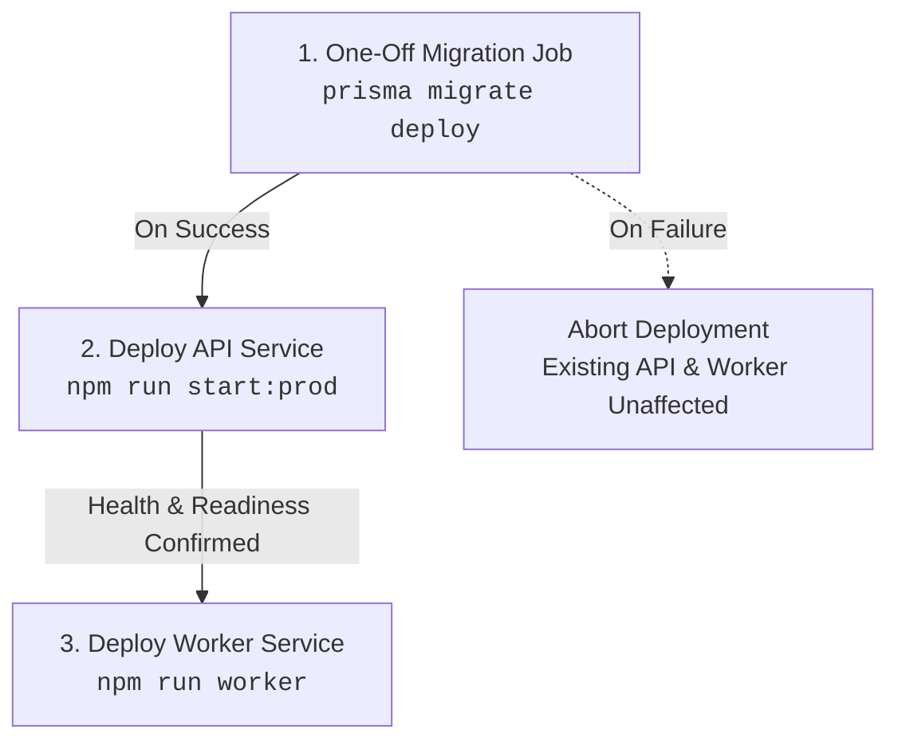

# Production Deployment Runbook

This runbook outlines the operational procedure for deploying new releases of the URL Shortener application across its decoupled services: the One-Off Migration Job, the API Service, and the Background Worker Service.

---

## 1. Release Order & Architecture Overview

To maintain zero downtime and prevent service interruption, deployments must strictly execute in the following sequential order:



### Why this order is required:
1. **Migrations First**: Database schema changes must be deployed *before* new application code boots if the application requires new columns, tables, or indexes. Because migrations follow the **expand-and-contract** principle (additive/backward-compatible changes only), running migrations first is completely safe for currently running previous-version API and worker instances.
2. **API Second**: The HTTP API is deployed next via rolling deployment. New instances handle incoming client requests and enqueue background jobs matching the updated contracts.
3. **Worker Third**: Background workers are updated to consume new or existing jobs from Redis. Idempotency guards (`ClickEvent.eventId` unique constraint) guarantee at-least-once delivery retry safety during the rollover.

---

## 2. Step-by-Step Deployment Instructions

### Step 1: Execute One-Off Migration Job

Run the migration command as a standalone release job or init container:

```bash
# In the production container environment:
npx prisma migrate deploy --config prisma7.config.ts

# Or using the local node_modules binary:
prisma migrate deploy
```

- **Required Environment Variable**: `DATABASE_URL` (production PostgreSQL connection string).
- **Execution Policy**:
  - Migrations **never run automatically** during API or Worker startup.
  - The job connects to PostgreSQL, reads `_prisma_migrations`, applies unapplied migrations from `prisma/migrations/`, and exits with code `0`.
- **Validation**:
  ```bash
  # Check migration status without modifying data:
  npx prisma migrate status --config prisma7.config.ts
  ```
  Expected output: `Database schema is up to date!`

### Step 2: Deploy API Service

Deploy the API service image with command:
```bash
npm run start:prod
```

- **Required Environment Variables**:
  - `PORT=3000` (or platform assigned port, e.g. `$PORT`)
  - `DATABASE_URL`
  - `REDIS_URL`
  - `JWT_SECRET` (minimum 32 characters)
  - `PUBLIC_BASE_URL` (e.g. `https://short.example.com`)
- **Process Verification**:
  The API binds to `0.0.0.0:${PORT}` without starting background queue listeners.

### Step 3: Deploy Background Worker Service

Deploy the background worker image with command:
```bash
npm run worker
```

- **Required Environment Variables**:
  - `DATABASE_URL`
  - `REDIS_URL`
  - `RETENTION_DAYS` (optional, default: 30)
- **Process Verification**:
  Logs emit:
  `[WorkerRunner] Analytics Worker is running and listening for queue jobs...`

---

## 3. Post-Deployment Verification & Health Checks

### 1. Liveness Check (Liveness Probe)
```bash
curl -f http://<api-host>:<port>/health
```
- **Expected Status**: `HTTP 200 OK`
- **Expected Payload**: `{"ok":true}`
- **Purpose**: Fast, lightweight verification that the Node.js event loop and HTTP server are responsive.

### 2. Readiness Check (Readiness Probe)
```bash
curl -f http://<api-host>:<port>/ready
```
- **Expected Status**: `HTTP 200 OK`
- **Expected Payload**:
  ```json
  {
    "status": "ready",
    "checks": {
      "database": "up",
      "redis": "up"
    }
  }
  ```
- **Purpose**: Confirms that both PostgreSQL (`SELECT 1;`) and Redis (`PING`) are responsive. If any required dependency is degraded or unreachable, returns `HTTP 503 Service Unavailable` with `{status: "not_ready"}` without routing client traffic.

### 3. Worker Processing Verification
Verify that background analytics processing is active:
1. **Trigger a redirect event**:
   ```bash
   curl -I -A "HealthCheckBot/1.0" http://<api-host>:<port>/r/<valid-code>
   ```
2. **Inspect Worker container logs**:
   ```text
   [AnalyticsWorker] Persisted click event: eventId=<uuid> linkId=<uuid>
   ```
3. **Verify analytics endpoint**:
   ```bash
   curl -H "Authorization: Bearer [REDACTED] http://<api-host>:<port>/links/<link-id>/analytics
   ```
   Confirm `total_clicks` reflects the redirect event.

---

## 4. Deployment Failure Handling

| Failure Scenario | Immediate Action | Operational State |
| :--- | :--- | :--- |
| **Migration Job Fails** | **Halt deployment immediately**. Do NOT proceed with API or Worker rollout. | Existing API and Worker continue serving traffic safely against unchanged schema. |
| **API Readiness Returns 503** | Platform halts rolling update. Keep previous API instances receiving traffic. | Check PostgreSQL / Redis connectivity and error logs. Fix dependency outage before retrying. |
| **Worker Crashes on Boot** | Platform restarts previous worker version. | Queue producer in API remains healthy. Redis BullMQ queue holds pending jobs up to retention limits. Durable fallback saves events directly to DB if queue is impaired. |

