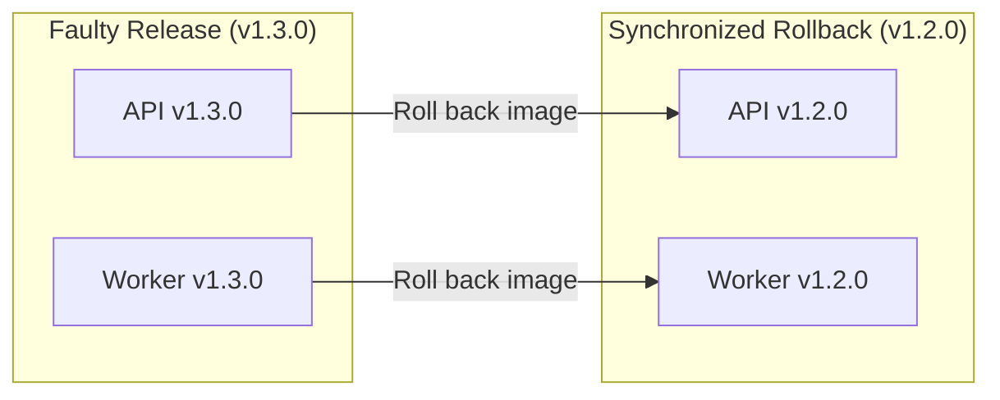
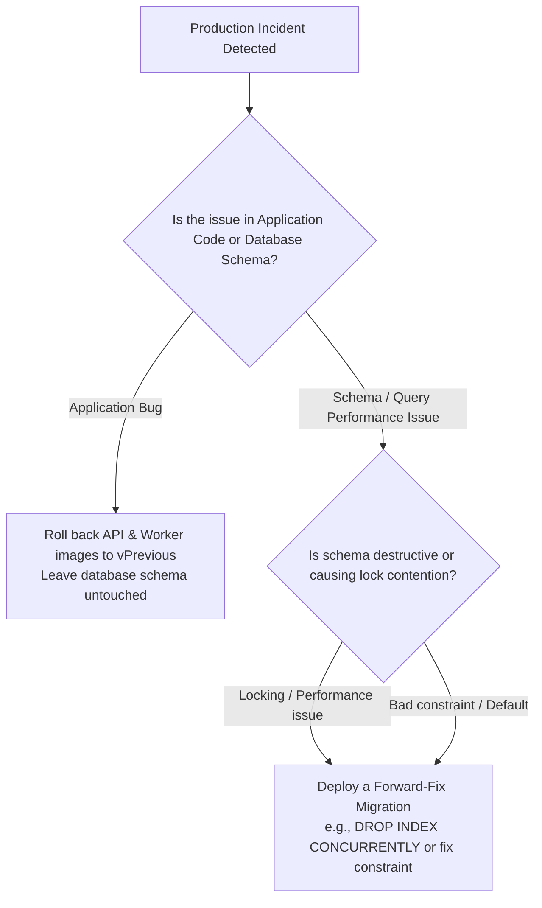

# Production Rollback Runbook

This runbook outlines the operational protocol and decision framework for executing rollbacks when a production incident, regression, or degraded performance occurs after a release.

---

## 1. Application Rollback Protocol (API & Worker)

### Synchronized Rollback
When rolling back application services, **both the API service and the Worker service must be rolled back together** to the matching previous release tag (e.g., from `v1.3.0` back to `v1.2.0`).

### Why synchronized rollback is mandatory:
- **Contract Mismatches**: If only the API is rolled back, older API instances may produce job payloads lacking metadata expected by newer workers, or vice versa.
- **Cache Format Drift**: Cached items in Redis (`redirect:<code}>`) use formats defined across API and worker helpers; version consistency prevents cache parsing errors.

---

## 2. Compatibility Risks: Queued Jobs & Database Schema

### A. In-Flight Queued Jobs in Redis
When rolling back while the system is under live load, jobs enqueued during the newer release (`v1.3.0`) may still reside in the BullMQ Redis queue (`analytics-queue`).
- **Risk**: Older worker versions (`v1.2.0`) will consume those jobs. If the new release introduced breaking payload changes (e.g., renamed fields), older workers will crash or fail job processing.
- **Rule of Additive Evolution**: Job payloads (`ClickEventJobData`) must always follow additive schemas:
  - New fields must be optional.
  - Never rename or delete existing fields without an intermediate deprecation cycle.
  - Older workers ignore unknown payload fields without throwing errors.

### B. Database Schema Compatibility (Expand-and-Contract)
- **Backward-Compatible Migrations**: All database migrations must be forward-compatible with the previous application release.
  - New columns must be `NULLABLE` or carry a database-level `DEFAULT`.
  - New tables can exist without affecting older code.
  - New indexes (e.g. GIN index for search in Module 8) do not break older queries.
- Because migrations are backward-compatible, rolling back application code (`API v1.2.0` and `Worker v1.2.0`) runs completely safely against the migrated schema!

---

## 3. Database Rollback Policy: Forward-Fix vs Reversing Migrations

### The Golden Rule: Never Blindly Reverse Applied Migrations
**Under no circumstances should database migrations be blindly reverted (`DROP TABLE`, `DROP COLUMN`) in a production incident.**

### Reasons:
1. **Catastrophic Data Loss**: If a new column or table was added and live users created links or clicks during the release window, executing a destructive rollback drops that production user data permanently.
2. **Prisma Forward-Only Design**: Prisma explicitly adopts a forward-only migration philosophy. `_prisma_migrations` records immutable migration checksums; manual deletion or manipulation of this table corrupts Prisma migration state.
3. **Multi-Service Deadlocks**: Attempting to alter or lock tables while active connections are reading can cause cascading query timeouts.

---

## 4. When to Use Forward-Fix vs Application Rollback

### Decision Framework:

1. **Scenario 1: Application Logic Bug, Route Regression, or Memory Leak**
   - **Resolution**: **Application Image Rollback**.
   - Re-deploy previous Docker images for API and Worker (`vPrevious`).
   - Do **NOT** touch the database. The backward-compatible schema continues serving the older application seamlessly.

2. **Scenario 2: Slow Index, Missing Index, or Restrictive Constraint**
   - **Resolution**: **Forward-Fix Migration**.
   - Do **NOT** attempt manual `pg_restore` or SQL `DROP`.
   - Author a new Prisma migration (e.g., `2026..._forward_fix_adjust_index`).
   - Run the migration via the One-Off Migration Job (`prisma migrate deploy`).
   - Deploy updated application images.

3. **Scenario 3: Corrupted Migration in `_prisma_migrations`**
   - Use `prisma migrate resolve --applied <migration_name>` or `--rolled-back <migration_name>` strictly after verifying the database state manually and confirming no table locks persist.
